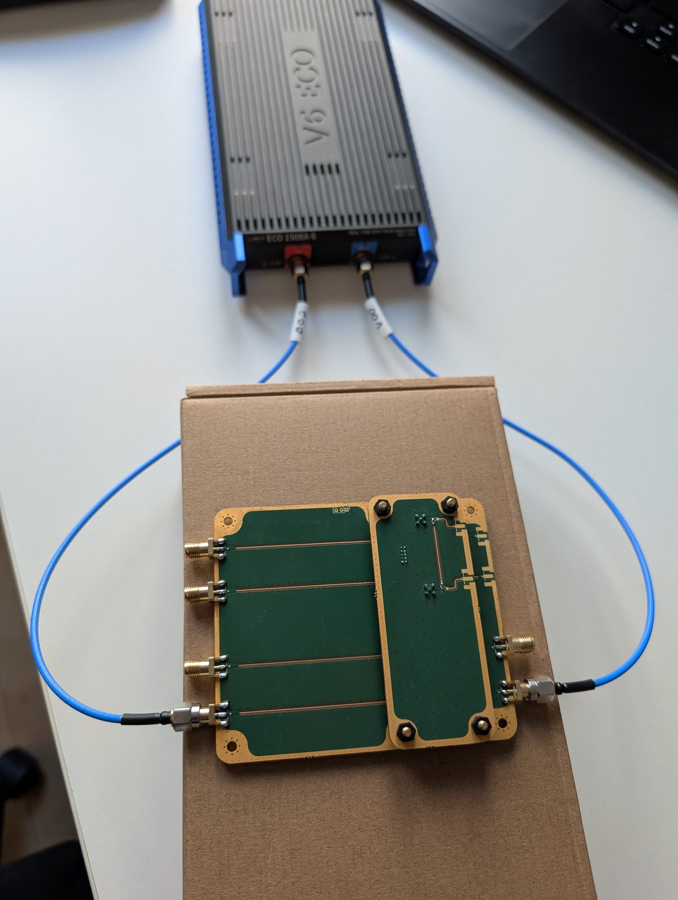
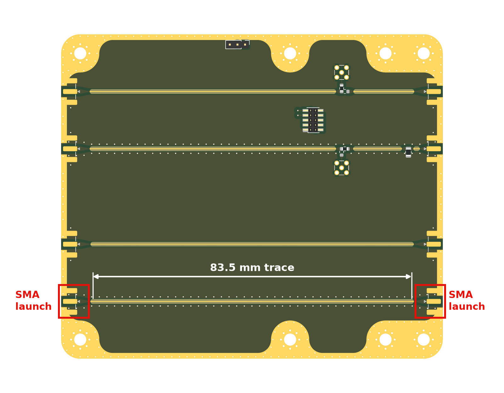
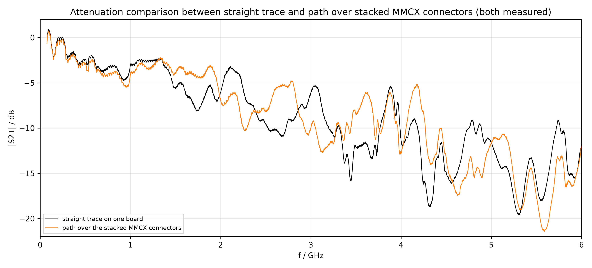
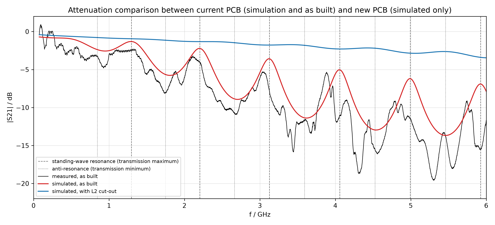
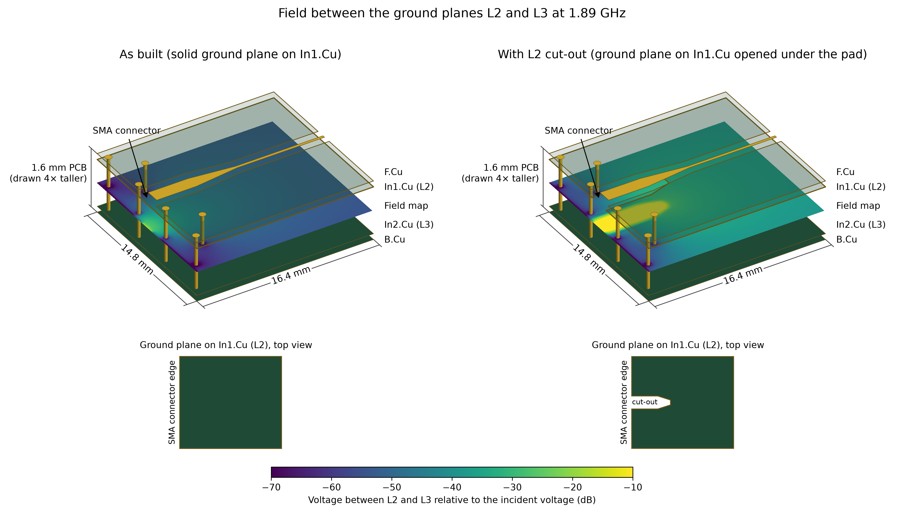

# RF experiments: MMCX transition and SMA edge launch

## Motivation and application

In early iterations of hophop open hardware boards, we considered having an on-board chip antenna,
but also a switchable antenna path through which a daughter board could easily take up the signal --
to add an antenna connector, to multiple antenna connectors for antenna diversity, or into a testbed.

We did not go with that design in the [Nymph](../grasshopper-nymph/) boards,
but might come back to this in later generations --
and either way, document the experiment and its outcome here.

## Experiment summary

Taking an RF signal into a daughterboard through stacked MMCX connectors works well: the path via the MMCX-pair stays within about 1 dB of a straight trace up to 6 GHz. The test boards nevertheless show strong reflections and standing waves on all four paths, the cause is the ground plane under the SMA edge launch, not the MMCX transition or the stackup. A simulation predicts that an L2 cut-out under the SMA centre pad, with vias beside it, removes the reflections. This has not been tested on a physical prototype yet.

## Setup

The two test boards are under `daughterboard-testing-bottom/` and `daughterboard-testing-top/` respectively and use the Aisler 4-layer 1.6 mm stackup. Transmission was measured up to 6 GHz with a spectrum analyser and tracking generator, which gives magnitude only, accurate to about ±1 dB.

The straight trace is connected; the daughterboard (`-top`) is the stacked smaller board on the right.

The straight-trace figures below refer to the marked trace, which can also be seen connected to the spectrum analyzer in above photograph.

## MMCX transition

Above plot should only be used to compare the two levels relatively and not absolutely over the frequency, the absolute values are discussed below. The two ripples have different spacings because the paths differ in length.

The band averages of the two paths are within about 1 dB of each other up to 6 GHz, so the MMCX connector shows no significant additional loss. This validates the general feasibility of connecting to a stacked daughterboard via MMCX.

## Reflections at the SMA edge launch

A simulation of the board matches the measurement very well. The insertion loss of the straight trace ripples across the whole band, by 8.6 dB peak to peak between 1 and 3 GHz and by 10.6 dB between 4 and 6 GHz.

The dashed lines mark the resonances estimated for a standing wave between the two SMA edge launches (roughly 83 mm apart), with their theoretical value of 0.93 GHz spacing against 0.89 GHz spacing measured.

## Cause and fix

The 50 Ω trace is 0.245 mm wide, which is correct for the stackup, but the SMA centre pad is 1.27 mm wide and sits 0.138 mm above a solid ground plane on layer 2 (L2), which makes it a microstrip line of about 16 Ω. Both SMA edge launches have this and therefore reflect, so the trace between them becomes a resonator and a standing wave forms.

Doing a full-wave simulation of the SMA edge launch in OpenEMS, the period and depth of the ripple can be reproduced well. The measured level lies 1.3 to 3 dB lower across the band, due to reasons which are outside of the model.

Removing the L2 ground under the pad, so that the pad references L3, removes the standing wave in the simulation. The PCB wasn't modified and manufactured again, so this could not be confirmed in measurements yet.

| Insertion loss of the straight trace, dB | 868 MHz | 1880–1900 MHz (DECT NR+) | 2.4 GHz band | 5.15–5.85 GHz |
| ---------------------------------------- | ------- | ------------------------ | ------------ | ------------- |
| Measured, as built                       | -3.8    | -5.4                     | -9.0         | -14.9         |
| Simulated, as built                      | -2.5    | -5.5                     | -6.3         | -11.9         |
| Simulated, with L2 cut-out               | -0.8    | -1.2                     | -1.3         | -2.8          |

As oppposed to the straight trace, the L2 cut-out benefits from vias beside it. Without them, 0.14 % of the incident power at 1.89 GHz and 2.5 % at 5.5 GHz escapes as a wave between L2 and L3; with the via fence beside the L2 cut-out it is below 0.01 %.

Both panels show an SMA edge launch with vias at the connector only. Looking at the field level away far from the connector at the other end/corners of the panel shows that the reflections are significantly reduced.

## Open points

- The dimensions of the L2 cut-out are a first guess, but it seems to work well.
- The trace impedance is unverified, that would needs S11 measurements (which can only be done with our setup with a directional coupler) or a TDR meter.
- The via fence along the trace showed no measurable effect, as suspected.
